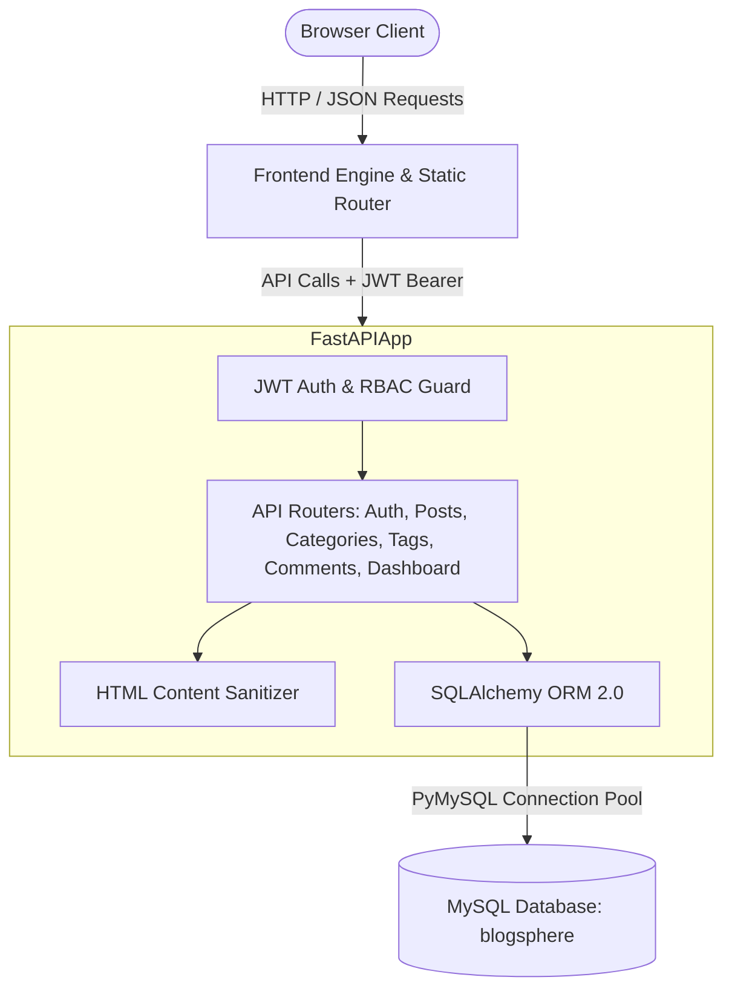

# 🌐 BlogSphere — Full-Stack Blog & Content Management System

[](https://python.org)
[](https://fastapi.tiangolo.com)
[](https://www.mysql.com)
[]()
[]()

**BlogSphere** is a modern, high-performance, full-stack blogging platform and Content Management System (CMS) engineered with **FastAPI**, **SQLAlchemy ORM**, **MySQL (InnoDB / XAMPP / WAMP)**, and a **vanilla HTML5/CSS3/JavaScript** frontend.

Designed from the ground up to reflect a real-world, production-ready publishing environment—not a beginner CRUD tutorial—it features complete JWT authentication, role-based authorization (User / Admin), automated slug generation with collision handling, live reading time calculations, HTML sanitization (XSS defense), view counter tracking, interactive tag chip inputs, dark/light themes, threaded comments, and a responsive administration suite.

---

## 📑 Table of Contents

- [Architectural Overview](#-architectural-overview)
- [Key Features](#-key-features)
- [Technology Stack](#-technology-stack)
- [Project Directory Structure](#-project-directory-structure)
- [Database Architecture & Schema](#-database-architecture--schema)
- [Environment Variables](#-environment-variables)
- [Local Setup & Installation](#-local-setup--installation)
- [Running the Application](#-running-the-application)
- [Pre-Seeded Demo Credentials](#-pre-seeded-demo-credentials)
- [Interactive API Documentation](#-interactive-api-documentation)
- [REST API Endpoints Reference](#-rest-api-endpoints-reference)
- [Automated Testing Suite](#-automated-testing-suite)
- [Security & Defense In Depth](#-security--defense-in-depth)

---

## 🏛️ Architectural Overview



---

## ✨ Key Features

### 🌍 Public Visitors
- **Responsive Magazine Feed**: 3-column desktop, 2-column tablet, 1-column mobile post cards.
- **Hero Showcase**: Prominently displays featured community articles with reading metrics.
- **Backend-Powered Search**: Real-time debounced search indexing post titles, excerpts, content, and tags (`GET /api/posts?search=...`).
- **Dynamic Category Filtering**: Database-driven category tabs with live post counts.
- **Article Reader View**: Complete typography hierarchy (`.prose`), sanitized HTML rendering, code syntax blocks, blockquotes, author bios, and publication dates.
- **View Counter**: Unique session view tracking incrementing `views_count` in MySQL.
- **Social Sharing**: One-click sharing to LinkedIn, X (Twitter), and clipboard copy with toast feedback.
- **Related Articles**: Recommendations based on shared category and matching tags.
- **Discussion System**: Threaded comments supporting both authenticated members and guest readers.

### ✍️ Authorized Authors
- **Authentication**: JWT authentication with bcrypt password hashing and token persistence.
- **Post Studio**:
  - Auto-generated URL slugs from article titles with manual override capability.
  - Interactive tag chip builder (type and press `Enter` or `,`).
  - Rich formatting toolbar (Bold, Italic, Headings H2/H3, Quotes, Code Blocks, Lists, Links).
  - Live writing stats (dynamic word count and calculated reading time `X min read`).
  - Side-by-side **Live Preview** tab with markdown-to-HTML rendering.
  - Featured image preview and category assignment.
  - Status management: Save as **Draft** or **Publish** immediately.
- **Author Dashboard**:
  - Live metric counters: Total Articles, Published, Drafts, and Total Views.
  - Post management data table with status badges and quick action controls (View, Edit, Toggle Publish/Unpublish, Delete with confirmation modal).
- **Profile Management**: Update public display name, biography, and author avatar image.

### 🛡️ Platform Administrators
- **Administrative Governance Portal** (`/pages/admin.html`):
  - **User Governance**: Inspect all registered users, toggle active/deactive status, promote or demote between `user` and `admin` roles.
  - **Category Management**: Create, edit, and delete categories with automated cascading rules.
  - **Tag Taxonomy**: View active tags with usage counters and prune outdated tags.
  - **Global Moderation**: View, edit, or delete any article across all platform authors.

### 🎨 Design & Accessibility
- **Theme Engine**: Light Mode, Dark Mode, and System Preference detection persisted in `localStorage`.
- **Toast Notifications**: Reusable, animated toast system for instant feedback.
- **Accessible Dialogs**: Modal confirmations for destructive operations (preventing accidental deletion).
- **Skeleton Shimmers**: Visual loading state placeholders while API data resolves.

---

## 🛠️ Technology Stack

| Layer | Technology | Details |
|---|---|---|
| **Backend Framework** | Python 3.11+ / FastAPI | High-throughput asynchronous REST API |
| **ORM & Driver** | SQLAlchemy 2.0 + PyMySQL | Connection pooling, pre-ping validation, relation cascades |
| **Database** | MySQL 5.7+ / 8.0+ / MariaDB | Tested with XAMPP, WAMP, and phpMyAdmin |
| **Security** | Passlib, Bcrypt 5.0, Python-Jose | 12-round bcrypt salt, HMAC-SHA256 JWT tokens |
| **Sanitization** | BeautifulSoup4 | Whitelist-based HTML filter for XSS protection |
| **Frontend** | HTML5, CSS3, Vanilla ES6+ JS | Zero heavy UI frameworks, native browser speed |
| **Testing** | Pytest 9.1+, HTTPX, TestClient | In-memory SQLite fixtures + live MySQL tests |

---

## 📁 Project Directory Structure

```text
c:\xampp\htdocs\QSkills - Task -2\
├── schema.sql                         # Complete standalone MySQL DDL schema
├── requirements.txt                   # Backend Python dependencies
├── .env.example                       # Environment template
├── .env                               # Local active environment configuration
├── run_server.py                      # One-click launcher for backend & frontend
│
├── backend/
│   ├── app/
│   │   ├── config.py                  # Pydantic BaseSettings & env loader
│   │   ├── database.py                # SQLAlchemy engine, session maker & get_db
│   │   ├── models.py                  # Declarative ORM models (Users, Posts, Tags, etc.)
│   │   ├── schemas.py                 # Pydantic v2 validation models
│   │   ├── auth.py                    # JWT extraction & role-based dependencies
│   │   ├── seed.py                    # Database seeder (users, articles, tags, comments)
│   │   ├── main.py                    # FastAPI application, CORS & static frontend mount
│   │   ├── utils/
│   │   │   ├── security.py            # Bcrypt hashing & JWT encode/decode
│   │   │   ├── sanitizer.py           # Content HTML sanitizer (XSS defense)
│   │   │   └── helpers.py             # Slug generator, reading time calculator
│   │   └── routes/
│   │       ├── auth.py                # /api/auth (register, login, logout, me)
│   │       ├── posts.py               # /api/posts (CRUD, search, slug, publish, views)
│   │       ├── categories.py          # /api/categories (CRUD, post counts)
│   │       ├── tags.py                # /api/tags (CRUD)
│   │       ├── users.py               # /api/users (profile, admin controls)
│   │       ├── dashboard.py           # /api/dashboard (stats, author posts)
│   │       └── comments.py            # /api/posts/{id}/comments
│   └── tests/
│       ├── conftest.py                # Pytest fixtures & in-memory test database
│       ├── test_auth.py               # Auth & registration tests
│       ├── test_posts.py              # Post CRUD, slug, views & permission tests
│       └── test_categories_tags.py    # Taxonomy & role tests
│
└── frontend/
    ├── index.html                     # Public homepage & article feed
    ├── assets/
    │   ├── logo.svg                   # Brand SVG logo
    │   └── default-avatar.svg         # Default author avatar
    ├── css/
    │   ├── style.css                  # Design tokens, themes (light/dark), reset
    │   ├── components.css             # Navigation, cards, modal, toast, prose styles
    │   └── responsive.css             # Tablet & mobile media queries
    ├── js/
    │   ├── api.js                     # Fetch wrapper with Bearer token interceptor
    │   ├── auth.js                    # Session state, login/logout, navbar sync
    │   ├── ui.js                      # Toast alerts, confirm modal, theme engine
    │   ├── posts.js                   # Homepage feed, search, post view & comments
    │   ├── dashboard.js               # Author dashboard metrics & posts table
    │   ├── editor.js                  # Post editor, auto-slug, tag chips, toolbar
    │   ├── admin.js                   # Admin user & category governance
    │   └── validation.js              # Client-side validation helpers
    └── pages/
        ├── post.html                  # Article details & reading experience
        ├── create-post.html           # New article editor
        ├── edit-post.html             # Existing article editor
        ├── dashboard.html             # Author & admin dashboard
        ├── login.html                 # Sign In with demo quick-fill
        ├── register.html              # Sign Up
        ├── profile.html               # Author profile & bio settings
        ├── categories.html            # Category topic directory
        └── admin.html                 # Administrator governance portal
```

---

## 🗄️ Database Architecture & Schema

The database is built on **MySQL (InnoDB)** using character set `utf8mb4`:

1. **`users`**: Unique email, hashed password, role (`user`, `admin`), profile image, bio, status (`is_active`).
2. **`user_settings`**: Theme preference, email notifications, visibility settings.
3. **`categories`**: Unique name, unique URL slug, description, author reference.
4. **`posts`**: Title, unique URL slug, excerpt, sanitized content (`LONGTEXT`), featured image URL, status (`draft`, `published`, `archived`), `is_featured`, `views_count`, `reading_time_minutes`, `published_at`.
5. **`tags`**: Unique tag name and URL-safe slug.
6. **`post_tags`**: Composite primary key `(post_id, tag_id)` for many-to-many relationship with foreign key cascades.
7. **`comments`**: Post reference, user reference or guest name/email, content, status (`approved`, `pending`, `spam`).
8. **`post_views`**: View logging tracking post ID, visitor identifier, IP hash, and timestamp to prevent duplicate counts.

### Importing Schema into MySQL / phpMyAdmin:
- Open phpMyAdmin at `http://localhost/phpmyadmin/`.
- Create or select the `blogsphere` database.
- Click **Import** and upload `schema.sql`, or execute it via terminal:
```bash
& "C:\xampp\mysql\bin\mysql.exe" -u root -e "SOURCE c:/xampp/htdocs/QSkills - Task -2/schema.sql"
```

---

## ⚙️ Environment Variables

The project reads settings from `.env`:

```ini
# Database Configuration (MySQL / XAMPP / WAMP)
DB_HOST=127.0.0.1
DB_PORT=3306
DB_USER=root
DB_PASSWORD=
DB_NAME=blogsphere

# Security & JWT Configuration
SECRET_KEY=blogsphere_super_secret_jwt_key_2026_change_in_production
ALGORITHM=HS256
ACCESS_TOKEN_EXPIRE_MINUTES=1440

# Server Configuration
APP_HOST=127.0.0.1
APP_PORT=8000
APP_DEBUG=True
CORS_ORIGINS=*
```

---

## 🚀 Local Setup & Installation

### Step 1: Start MySQL in XAMPP / WAMP
Make sure MySQL is running on port `3306` (via the XAMPP Control Panel).

### Step 2: Install Python Dependencies
Open PowerShell or your terminal in the project directory:
```bash
cd "c:\xampp\htdocs\QSkills - Task -2"
python -m pip install -r requirements.txt
```

### Step 3: Seed Database with Demo Content
Run the automated seeder to populate sample users, categories, tags, and articles:
```bash
python backend/app/seed.py
```

---

## 💻 Running the Application

### Option A: Unified FastAPI Full-Stack Server (Recommended)
FastAPI directly serves the backend APIs and mounts the frontend:
```bash
python run_server.py
```
Or with uvicorn directly:
```bash
python -m uvicorn backend.app.main:app --host 127.0.0.1 --port 8000 --reload
```

- **Web Frontend**: [http://127.0.0.1:8000/](http://127.0.0.1:8000/)
- **Interactive Swagger API Docs**: [http://127.0.0.1:8000/docs](http://127.0.0.1:8000/docs)
- **ReDoc API Documentation**: [http://127.0.0.1:8000/redoc](http://127.0.0.1:8000/redoc)

### Option B: Apache (XAMPP) + FastAPI API Server
If Apache is running in XAMPP, you can open:
`http://localhost/QSkills - Task -2/frontend/`
*(The API client in `frontend/js/api.js` automatically detects this and communicates with `http://127.0.0.1:8000/api` seamlessly).*

---

## 🔑 Pre-Seeded Demo Credentials

| Role | Name | Email | Password |
|---|---|---|---|
| **Admin** | Saksham Pandey | `admin@blogsphere.dev` | `AdminPassword123!` |
| **Author** | Alex Morgan | `alex.morgan@blogsphere.dev` | `AuthorPassword123!` |
| **Author** | Sophia Chen | `sophia.chen@blogsphere.dev` | `AuthorPassword123!` |

*(On the Login screen, click **"🛡️ Fill Admin"** or **"✍️ Fill Author"** for instant 1-click credential filling).*

---

## 📡 REST API Endpoints Reference

### Authentication (`/api/auth`)
- `POST /api/auth/register` — Register new user account.
- `POST /api/auth/login` — Authenticate and retrieve JWT Bearer token.
- `POST /api/auth/logout` — Invalidate user session.
- `GET /api/auth/me` — Retrieve current user profile and settings.

### Articles & Posts (`/api/posts`)
- `GET /api/posts` — List published posts (supports `page`, `limit`, `search`, `category`, `tag`, `featured`).
- `GET /api/posts/slug/{slug}` — Fetch post by unique slug & record view.
- `GET /api/posts/{id}` — Fetch post by numeric ID.
- `POST /api/posts` — Create a new post (Draft or Published).
- `PUT /api/posts/{id}` — Update an existing post (Author or Admin).
- `DELETE /api/posts/{id}` — Permanently delete an article.
- `PATCH /api/posts/{id}/publish` — Quick-publish an article.
- `PATCH /api/posts/{id}/unpublish` — Return an article to draft status.
- `GET /api/posts/{id}/related` — Fetch related articles based on category/tags.

### Categories (`/api/categories`)
- `GET /api/categories` — List all categories with published post counts.
- `POST /api/categories` — Create a new category *(Admin only)*.
- `PUT /api/categories/{id}` — Update category details *(Admin only)*.
- `DELETE /api/categories/{id}` — Remove a category *(Admin only)*.

### Tags (`/api/tags`)
- `GET /api/tags` — List all tags with usage counts.
- `POST /api/tags` — Create a tag *(Authenticated users)*.
- `DELETE /api/tags/{id}` — Delete a tag *(Admin only)*.

### Discussion & Comments (`/api/posts/{id}/comments`)
- `GET /api/posts/{id}/comments` — List approved comments for an article.
- `POST /api/posts/{id}/comments` — Submit a comment (Authenticated or Guest).
- `DELETE /api/comments/{id}` — Delete a comment (Author or Admin).

### Author Dashboard (`/api/dashboard`)
- `GET /api/dashboard/stats` — Retrieve author article metrics and platform summary.
- `GET /api/dashboard/posts` — List author posts with status filtering.

### Governance & Users (`/api/users`)
- `GET /api/users/me` — Retrieve current user profile with post metrics.
- `PUT /api/users/me` — Update display name, avatar, and bio.
- `GET /api/users` — List all registered users *(Admin only)*.
- `PATCH /api/users/{id}/status` — Toggle user active/inactive status *(Admin only)*.
- `PATCH /api/users/{id}/role` — Update user role between `user` and `admin` *(Admin only)*.

---

## 🧪 Automated Testing Suite

The application includes an extensive automated test suite covering authentication, authorization rules, post lifecycles, XSS content sanitization, slug collision resolution, and admin permissions.

Execute tests with pytest:
```bash
python -m pytest backend/tests -v
```

### Verified Test Cases:
- `test_register_success` — Registers new author with valid credentials.
- `test_register_duplicate_email` — Verifies rejection of duplicate email (400 Bad Request).
- `test_register_short_password` — Verifies password length constraints (422 Unprocessable Entity).
- `test_login_success` — Validates authentication and token issuing.
- `test_login_invalid_password` — Rejects incorrect passwords (401 Unauthorized).
- `test_login_nonexistent_user` — Rejects unknown emails.
- `test_get_me_authenticated` — Returns profile for valid Bearer token.
- `test_get_me_unauthenticated` — Blocks unauthenticated requests.
- `test_create_post_success` — Creates article, assigns author ID, calculates reading time.
- `test_html_sanitization_in_post` — Verifies malicious `<script>` and `javascript:` tags are sanitized.
- `test_create_post_unauthenticated` — Prevents unauthorized article creation.
- `test_get_posts_public` — Confirms public visitors only see published posts.
- `test_author_can_view_own_draft` — Verifies author can view own draft while public cannot.
- `test_unauthorized_user_cannot_update_post` — **Enforces RBAC**: User A cannot edit User B's post.
- `test_admin_can_update_any_post` — Confirms administrators can moderate any article.
- `test_search_and_category_filtering` — Verifies keyword and tag query filtering.
- `test_publish_and_unpublish` — Verifies state transitions between published and draft.
- `test_delete_post` — Tests permanent deletion with relationship cascading.
- `test_list_categories` & `test_create_category_admin_only` — Tests category endpoints and admin protection.
- `test_list_tags` & `test_create_tag_authenticated` — Tests tag creation and retrieval.

---

## 🛡️ Security & Defense In Depth

1. **Password Security**: Passwords are never stored in plaintext. Hashing is performed using native `bcrypt` with 12 automatic salt rounds.
2. **Token Security**: JWT tokens are cryptographically signed with HMAC-SHA256 (`HS256`) and carry explicit expiration timestamps.
3. **Strict Authorization (RBAC)**: Backend endpoints strictly check author ownership and admin privileges. Frontend UI hiding is never solely relied upon.
4. **SQL Injection Prevention**: All queries use SQLAlchemy ORM with parameterized SQL inputs. No raw unsanitized SQL string concatenation.
5. **Cross-Site Scripting (XSS) Prevention**: Submitted article HTML is processed through a strict whitelist sanitizer (`BeautifulSoup4`), stripping `<script>`, `<iframe>`, `javascript:`, and dangerous `on*` event handlers.
6. **Error Masking**: Database internals and raw tracebacks are concealed behind uniform JSON responses in production environments.

---

## 📜 License

This project is licensed under the **MIT License**.
