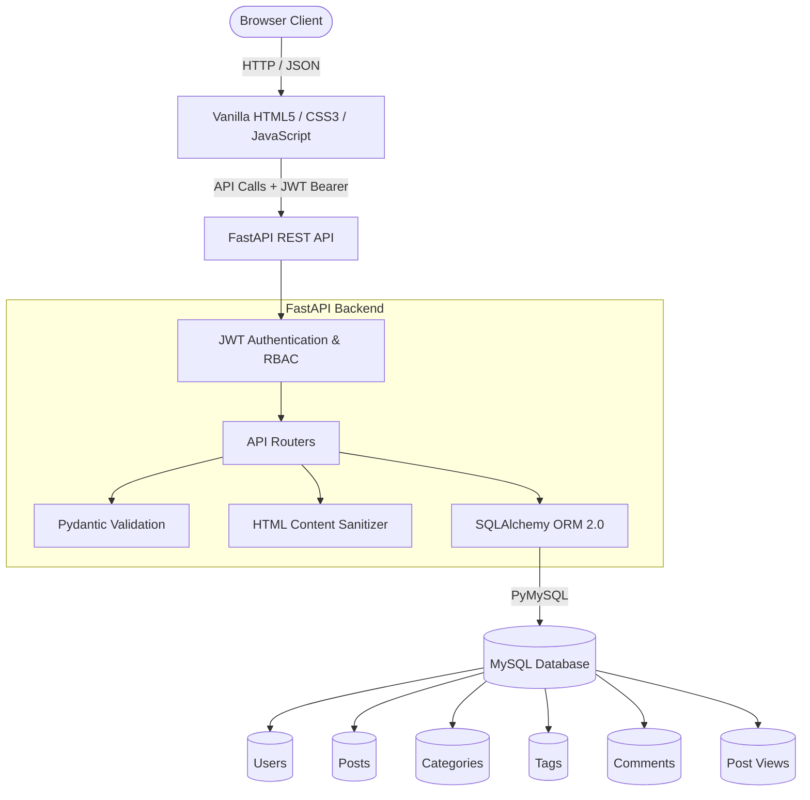
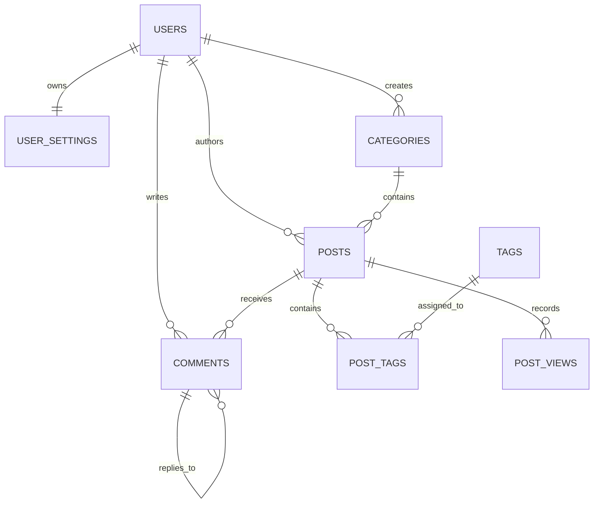
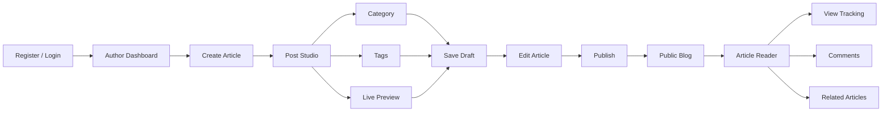

# 🌐 BlogSphere — Full-Stack Blog & Content Management System

[](https://python.org)
[](https://fastapi.tiangolo.com)
[](https://www.mysql.com)
[]()
[](https://developer.mozilla.org/en-US/docs/Web/JavaScript)
[]()

**BlogSphere** is a modern, high-performance, full-stack blogging platform and Content Management System (CMS) engineered with **FastAPI**, **SQLAlchemy ORM**, **MySQL (InnoDB / XAMPP / WAMP)**, and a **vanilla HTML5/CSS3/JavaScript** frontend.

Designed to reflect a real-world publishing environment rather than a basic CRUD tutorial, BlogSphere provides complete JWT authentication, role-based authorization, automated slug generation with collision handling, live reading-time calculations, HTML sanitization for XSS defense, view tracking, interactive tag inputs, dark/light themes, threaded comments, author dashboards, and a responsive administration suite.

The platform provides a complete publishing workflow from registration and authentication to article creation, drafting, publishing, discovery, reading, comments, moderation, and administration.

---

## 📑 Table of Contents

- [Architectural Overview](#-architectural-overview)
- [Key Features](#-key-features)
- [Technology Stack](#-technology-stack)
- [Project Directory Structure](#-project-directory-structure)
- [Database Architecture & Schema](#-database-architecture--schema)
- [Environment Variables](#-environment-variables)
- [Local Setup & Installation](#-local-setup--installation)
- [Running the Application](#-running-the-application)
- [Pre-Seeded Demo Credentials](#-pre-seeded-demo-credentials)
- [Interactive API Documentation](#-interactive-api-documentation)
- [REST API Endpoints Reference](#-rest-api-endpoints-reference)
- [Publishing Workflow](#-publishing-workflow)
- [Automated Testing Suite](#-automated-testing-suite)
- [Security & Defense in Depth](#-security--defense-in-depth)
- [Key Learning Outcomes](#-key-learning-outcomes)
- [Developer](#-developer)
- [License](#-license)

---

## 🏛️ Architectural Overview



---

## ✨ Key Features

## 🌍 Public Visitors

- Responsive magazine-style feed
- 3-column desktop layout
- 2-column tablet layout
- 1-column mobile layout
- Featured article showcase
- Reading metrics
- Backend-powered search
- Search across titles, excerpts, content, and tags
- Dynamic category filtering
- Live category post counts
- Article reader view
- Structured typography
- Sanitized HTML rendering
- Code blocks
- Blockquotes
- Author information
- Publication dates
- View counter
- Related articles
- Social sharing
- LinkedIn sharing
- X/Twitter sharing
- Clipboard copy
- Toast feedback
- Public comments
- Threaded discussions
- Guest reader comments where supported

---

## ✍️ Authorized Authors

### Authentication

Authors can:

- Register
- Login
- Logout
- Access protected resources
- Maintain authenticated sessions
- Manage profiles

Authentication uses:

- JWT
- bcrypt
- Bearer-token authorization

### Post Studio

The editor provides:

- Automatic URL slug generation
- Manual slug override
- Slug collision handling
- Interactive tag-chip builder
- Rich formatting toolbar
- Bold
- Italic
- H2/H3 headings
- Quotes
- Code blocks
- Lists
- Links
- Live word count
- Reading-time calculation
- Live preview
- Featured image preview
- Category assignment
- Draft saving
- Immediate publishing

### Author Dashboard

Dashboard metrics include:

- Total Articles
- Published Articles
- Drafts
- Total Views

Post management supports:

- View
- Edit
- Publish
- Unpublish
- Delete
- Confirmation dialogs
- Status badges

### Profile Management

Authors can manage:

- Display name
- Biography
- Avatar/profile image
- Public profile information

---

## 🛡️ Platform Administrators

BlogSphere includes an administration portal.

### User Governance

Administrators can:

- Inspect registered users
- Activate/deactivate accounts
- Promote users to admin
- Demote admins to users
- Manage user accounts

### Category Management

Administrators can:

- Create categories
- Edit categories
- Delete categories
- Manage category metadata

### Tag Taxonomy

Administrators can:

- View tags
- View usage counts
- Remove outdated tags
- Maintain the platform taxonomy

### Global Moderation

Administrators can:

- View articles
- Edit articles
- Delete articles
- Moderate content across authors

---

## 🎨 Design & Accessibility

### 🌓 Theme Engine

Supports:

- Light Mode
- Dark Mode
- System preference detection
- Persistent theme settings using `localStorage`

### 🔔 Toast Notifications

Reusable animated notifications provide feedback for:

- Successful operations
- Errors
- Authentication
- Content actions
- Validation

### ⚠️ Accessible Dialogs

Confirmation dialogs are used for destructive operations such as:

- Delete post
- Delete category
- Delete tag
- Other irreversible actions

### 💀 Loading States

Skeleton shimmer placeholders provide visual feedback while API data is loading.

---

## 🛠️ Technology Stack

| Layer | Technology | Details |
|---|---|---|
| Backend | Python 3.11+ / FastAPI | REST API |
| ORM | SQLAlchemy 2.0 | Database ORM |
| Driver | PyMySQL | MySQL connectivity |
| Database | MySQL / InnoDB | Relational storage |
| Authentication | JWT | Bearer-token authentication |
| Password Security | bcrypt | Password hashing |
| Authorization | Role-Based Access Control | User/Admin permissions |
| Sanitization | BeautifulSoup4 | XSS protection |
| Frontend | HTML5 / CSS3 / Vanilla ES6+ JS | Responsive UI |
| Testing | Pytest / HTTPX / TestClient | Automated testing |
| Local Database Tools | XAMPP / WAMP / phpMyAdmin | Development |
| API Documentation | Swagger / ReDoc | Interactive API docs |

---

## 📁 Project Directory Structure

```text
QSkills - Task -2/
│
├── schema.sql
├── requirements.txt
├── .env.example
├── .env
├── run_server.py
│
├── backend/
│   ├── app/
│   │   ├── config.py
│   │   ├── database.py
│   │   ├── models.py
│   │   ├── schemas.py
│   │   ├── auth.py
│   │   ├── seed.py
│   │   ├── main.py
│   │   │
│   │   ├── utils/
│   │   │   ├── security.py
│   │   │   ├── sanitizer.py
│   │   │   └── helpers.py
│   │   │
│   │   └── routes/
│   │       ├── auth.py
│   │       ├── posts.py
│   │       ├── categories.py
│   │       ├── tags.py
│   │       ├── users.py
│   │       ├── dashboard.py
│   │       └── comments.py
│   │
│   └── tests/
│       ├── conftest.py
│       ├── test_auth.py
│       ├── test_posts.py
│       └── test_categories_tags.py
│
└── frontend/
    ├── index.html
    │
    ├── assets/
    │   ├── logo.svg
    │   └── default-avatar.svg
    │
    ├── css/
    │   ├── style.css
    │   ├── components.css
    │   └── responsive.css
    │
    ├── js/
    │   ├── api.js
    │   ├── auth.js
    │   ├── ui.js
    │   ├── posts.js
    │   ├── dashboard.js
    │   ├── editor.js
    │   ├── admin.js
    │   └── validation.js
    │
    └── pages/
        ├── post.html
        ├── create-post.html
        ├── edit-post.html
        ├── dashboard.html
        ├── login.html
        ├── register.html
        ├── profile.html
        ├── categories.html
        └── admin.html
```

---

## 🗄️ Database Architecture & Schema

The database uses **MySQL / InnoDB** with `utf8mb4` character encoding.

### `users`

Stores:

- Unique email
- Hashed password
- Role
- Display name
- Profile image
- Biography
- Active/inactive status
- Timestamps

### `user_settings`

Stores:

- Theme preference
- Email notification settings
- Visibility preferences

### `categories`

Stores:

- Category name
- Unique URL slug
- Description
- Author/reference information

### `posts`

Stores:

- Title
- Unique URL slug
- Excerpt
- Sanitized content
- Featured image
- Status
- Featured flag
- View count
- Reading time
- Publication date
- Author
- Category

Supported statuses:

```text
draft
published
archived
```

### `tags`

Stores:

- Tag name
- URL-safe slug

### `post_tags`

Provides the many-to-many relationship between posts and tags.

```text
post_id ↔ tag_id
```

### `comments`

Supports:

- Authenticated comments
- Guest comments where enabled
- Comment content
- Comment status
- Threaded relationships
- Post references
- User references

### `post_views`

Tracks:

- Post ID
- Visitor identifier
- IP hash
- Timestamp

This supports view tracking and duplicate-view prevention.

---

## 🧬 Database Relationship Diagram



---

## ⚙️ Environment Variables

Create a local `.env` file.

Example:

```ini
DB_HOST=127.0.0.1
DB_PORT=3306
DB_USER=root
DB_PASSWORD=
DB_NAME=blogsphere

SECRET_KEY=change_this_secret_key_in_production
ALGORITHM=HS256
ACCESS_TOKEN_EXPIRE_MINUTES=1440

APP_HOST=127.0.0.1
APP_PORT=8000
APP_DEBUG=True

CORS_ORIGINS=*
```

> **Security:** Never commit the actual `.env` file or production secrets to GitHub.

---

## 🚀 Local Setup & Installation

### Step 1 — Start MySQL

Start MySQL using XAMPP, WAMP, or MySQL Server.

Default port:

```text
3306
```

### Step 2 — Create Database

Open:

```text
http://localhost/phpmyadmin/
```

Create:

```text
blogsphere
```

### Step 3 — Import Schema

Import:

```text
schema.sql
```

using phpMyAdmin.

Or use the MySQL command line:

```bash
mysql -u root -p
```

Then:

```sql
SOURCE schema.sql;
```

### Step 4 — Create Virtual Environment

Windows:

```bash
python -m venv venv
venv\Scripts\activate
```

Linux/macOS:

```bash
python3 -m venv venv
source venv/bin/activate
```

### Step 5 — Install Dependencies

```bash
python -m pip install -r requirements.txt
```

If required:

```bash
pip install fastapi uvicorn[standard] sqlalchemy pymysql cryptography pydantic pydantic-settings python-jose[cryptography] bcrypt python-dotenv beautifulsoup4 pytest httpx
```

### Step 6 — Configure Environment

Create `.env` using `.env.example` and configure:

```ini
DB_HOST=127.0.0.1
DB_PORT=3306
DB_USER=root
DB_PASSWORD=
DB_NAME=blogsphere

SECRET_KEY=your_secret_key
ALGORITHM=HS256
ACCESS_TOKEN_EXPIRE_MINUTES=1440
```

### Step 7 — Seed Demo Data

```bash
python backend/app/seed.py
```

---

## 💻 Running the Application

### Option A — Unified Server

Recommended:

```bash
python run_server.py
```

### Option B — Uvicorn

```bash
python -m uvicorn backend.app.main:app --host 127.0.0.1 --port 8000 --reload
```

### Frontend

```text
http://127.0.0.1:8000/
```

### Swagger

```text
http://127.0.0.1:8000/docs
```

### ReDoc

```text
http://127.0.0.1:8000/redoc
```

---

## 🔑 Pre-Seeded Demo Credentials

| Role | Name | Email | Password |
|---|---|---|---|
| **Admin** | Saksham Pandey | `admin@blogsphere.dev` | `AdminPassword123!` |
| **Author** | Alex Morgan | `alex.morgan@blogsphere.dev` | `AuthorPassword123!` |
| **Author** | Sophia Chen | `sophia.chen@blogsphere.dev` | `AuthorPassword123!` |

The login interface can provide quick-fill options:

```text
🛡️ Fill Admin
✍️ Fill Author
```

> Change demo credentials and secrets before deploying publicly.

---

## 📚 Interactive API Documentation

### Swagger UI

```text
http://127.0.0.1:8000/docs
```

Swagger provides:

- Endpoint inspection
- Request schema inspection
- API testing
- Bearer authentication
- Response inspection
- Backend debugging

### ReDoc

```text
http://127.0.0.1:8000/redoc
```

---

## 📡 REST API Endpoints Reference

### Authentication — `/api/auth`

```text
POST /api/auth/register
POST /api/auth/login
POST /api/auth/logout
GET  /api/auth/me
```

### Articles — `/api/posts`

```text
GET    /api/posts
GET    /api/posts/slug/{slug}
GET    /api/posts/{id}
POST   /api/posts
PUT    /api/posts/{id}
DELETE /api/posts/{id}
PATCH  /api/posts/{id}/publish
PATCH  /api/posts/{id}/unpublish
GET    /api/posts/{id}/related
```

Supported listing parameters include:

```text
page
limit
search
category
tag
featured
```

### Categories — `/api/categories`

```text
GET    /api/categories
POST   /api/categories
PUT    /api/categories/{id}
DELETE /api/categories/{id}
```

### Tags — `/api/tags`

```text
GET    /api/tags
POST   /api/tags
DELETE /api/tags/{id}
```

### Comments

```text
GET    /api/posts/{id}/comments
POST   /api/posts/{id}/comments
DELETE /api/comments/{id}
```

### Dashboard

```text
GET /api/dashboard/stats
GET /api/dashboard/posts
```

### Users

```text
GET   /api/users/me
PUT   /api/users/me
GET   /api/users
PATCH /api/users/{id}/status
PATCH /api/users/{id}/role
```

---

## 🔄 Publishing Workflow



---

## 🧪 Automated Testing Suite

The application includes automated tests covering authentication, authorization, posts, security, categories, tags, and important business rules.

Run:

```bash
python -m pytest backend/tests -v
```

### Verified Test Areas

- Successful registration
- Duplicate email rejection
- Password validation
- Successful login
- Invalid password rejection
- Nonexistent-user rejection
- Authenticated `/me` access
- Unauthenticated access protection
- Successful post creation
- Reading-time calculation
- HTML sanitization
- Unauthorized post creation prevention
- Public post visibility
- Author draft access
- Ownership-based update protection
- Admin post management
- Search and category filtering
- Publishing
- Unpublishing
- Post deletion
- Relationship cascading
- Category listing
- Admin-only category creation
- Tag listing
- Authenticated tag creation

### Test Count

```text
22 automated tests
```

---

## 🛡️ Security & Defense in Depth

### 1. Password Security

Passwords are not stored as plaintext.

The application uses bcrypt-based password hashing.

### 2. JWT Security

JWT tokens are cryptographically signed and contain expiration information.

Configured algorithm:

```text
HS256
```

### 3. Role-Based Access Control

Supported roles:

```text
user
admin
```

Backend authorization is enforced independently of frontend UI visibility.

### 4. Ownership Protection

Authors cannot modify another author's protected content unless they have appropriate administrative permissions.

### 5. SQL Injection Prevention

SQLAlchemy ORM and parameterized database operations are used instead of unsafe SQL string concatenation.

### 6. XSS Protection

Article HTML is sanitized before processing.

Dangerous content such as:

```text
<script>
javascript:
<iframe>
onerror=
onclick=
```

is handled by the application's sanitization rules.

### 7. Environment Security

Sensitive values should remain in:

```text
.env
```

and should never be committed to a public repository.

### 8. Error Handling

Application errors are returned through structured API responses rather than unnecessarily exposing internal implementation details.

---

## 📊 Platform Capability Overview

```text
                       BLOGSPHERE
                           │
          ┌────────────────┼────────────────┐
          │                │                │
       Readers          Authors          Admins
          │                │                │
          │                │                │
      Browse Posts     Create Posts     Manage Users
      Search           Edit Posts       Manage Roles
      Categories       Draft Posts      Manage Categories
      Read Articles    Publish          Manage Tags
      Comments         Unpublish        Moderate Content
      View Tracking    Dashboard        Platform Control
          │                │                │
          └────────────────┼────────────────┘
                           │
                    FastAPI REST API
                           │
                     SQLAlchemy ORM
                           │
                      MySQL Database
```

---

## 💡 Key Learning Outcomes

This project demonstrates practical experience with:

- Full-stack web development
- FastAPI
- Python
- SQLAlchemy ORM
- MySQL
- REST API architecture
- JWT authentication
- bcrypt password hashing
- Role-based authorization
- CRUD operations
- Relational database design
- Blog/CMS architecture
- Publishing workflows
- Draft and publish systems
- Categories
- Tags
- Search and filtering
- Comments
- Threaded discussions
- View tracking
- HTML sanitization
- XSS defense
- Responsive frontend development
- Vanilla JavaScript
- Automated API testing
- Git and GitHub
- Environment-based configuration
- Application security

---

## 👨‍💻 Developer

**Saksham Pandey**

**BS-MS in Artificial Intelligence and Cybersecurity**  
**IIT Patna**

GitHub:  
https://github.com/sakshampandey380

LinkedIn:  
https://www.linkedin.com/in/saksham-pandey-184515250/

---

## 📜 License

This project is licensed under the **MIT License**.

The application was developed as part of a **Full-Stack Development Internship / QSkills Assessment** and is intended for educational, demonstration, and portfolio purposes.
